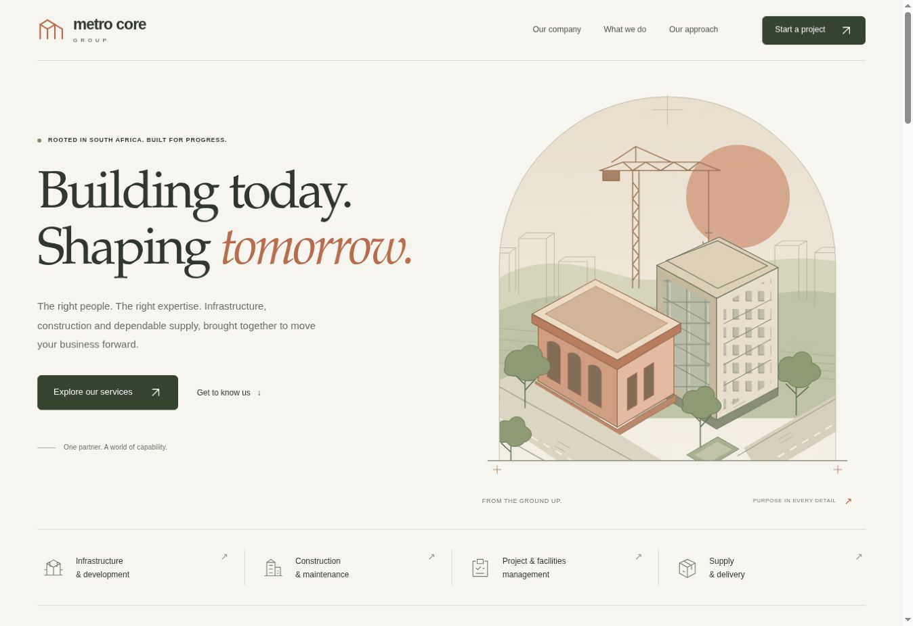

# Metro Core Group — Website Concept

A lightweight, responsive website concept for Metro Core Group (Pty) Ltd, based on the supplied corporate company profile.

## Preview the website

**[Open the live client preview](https://motloungseabelo-gif.github.io/metro-core-group-website/)**

GitHub Pages is enabled from the `main` branch, `/ (root)`. Future commits to that branch update the preview automatically. For a local preview, open `index.html` in a browser or use any static web server. No installation or build step is required.

## What is included

- Warm editorial design with original architectural SVG illustrations
- Responsive desktop, tablet and phone layouts
- Company overview and public/private-sector audiences
- Five expandable service areas
- Company values and compliance commitments
- Downloadable original company profile
- Project brief builder with text download and clipboard copy
- Keyboard navigation, labelled form fields, visible focus and reduced-motion styles
- Local fonts and assets, with no external runtime dependencies

## Project enquiries

The supplied profile does not provide a contact email, telephone number or physical address. The project brief builder therefore prepares a file for visitors to share themselves; it does not send an enquiry. Form data is kept only in page memory and is not sent to a server or saved in browser storage.

Verified contact details and an enquiry delivery service can be added before the client launches the site.

## Files

- `index.html` — content and semantic structure
- `styles.css` — responsive styling
- `app.js` — navigation, service disclosures and project brief interactions
- `assets/` — original SVG artwork, fonts, their licence and the original company profile PDF
- `.nojekyll` — enables direct static serving on GitHub Pages

## Content and artwork

Service descriptions, audiences and company principles are based on the supplied profile. No completed projects, customer logos, testimonials, registration numbers or confirmed certification statuses are invented. Architectural artwork is illustrative and does not represent a completed company project. The profile download is the original supplied PDF.

The fonts' licence is included in `assets/font-license.txt`. Company content and branding are not assigned an open-source licence by this repository.

## Verification

JavaScript syntax, local resource links, section anchors, IDs, form labels, ARIA references, SVGs, structured data and integrity of the original PDF were checked. After publication, live desktop rendering, service deep links, automatic service selection and project-brief generation were also verified in a browser. Phone layouts are implemented with responsive styles; testing on physical devices remains outstanding.

The website includes noindex metadata while it is a client concept. Remove that restriction when the company approves a public launch.
